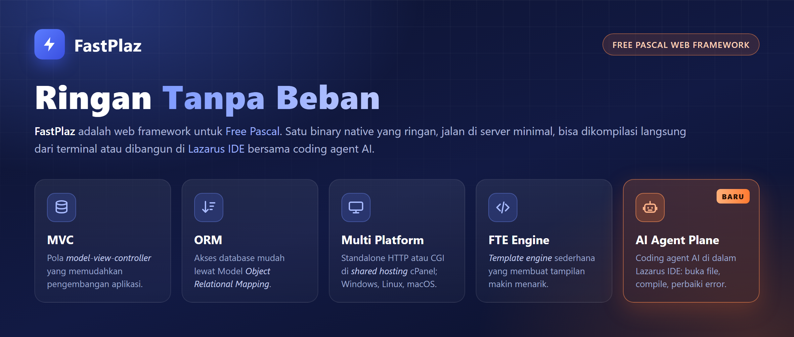
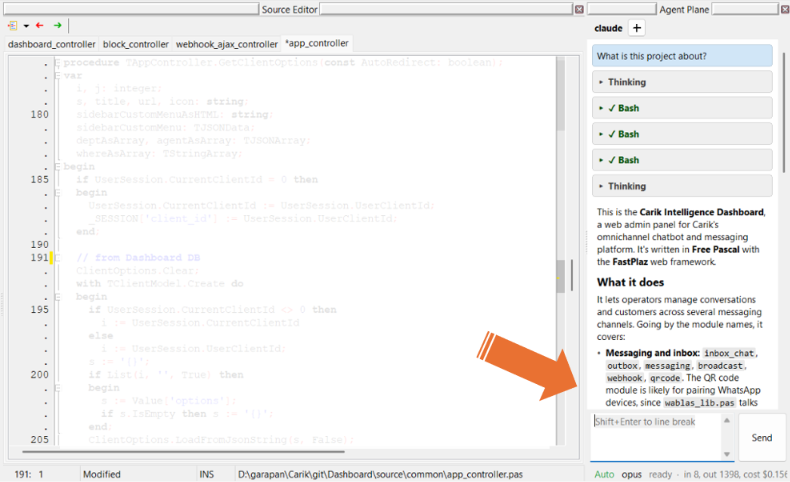
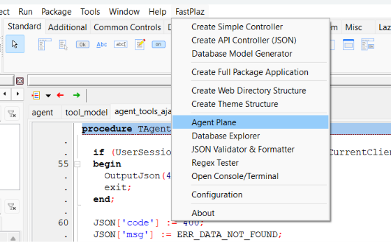
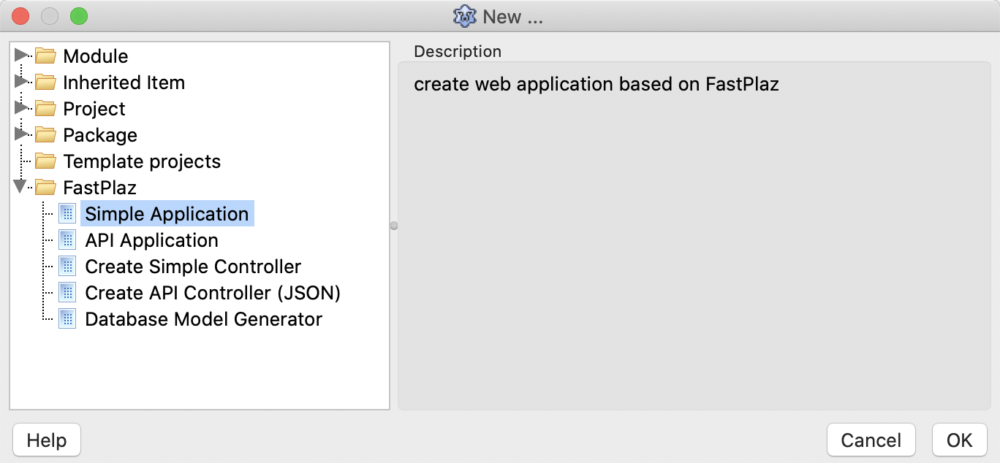

# FastPlaz

[English](README.md) | **Bahasa Indonesia**




**Aplikasi web native yang cepat, dengan Free Pascal.**

[FastPlaz](https://www.fastplaz.com) adalah web framework untuk Free Pascal. Aplikasi Anda di-_compile_ menjadi satu binary native yang bisa berjalan di shared hosting murah sebagai CGI, atau sebagai HTTP server sendiri. Development bisa melalui Lazarus IDE dengan wizard project dan AI coding agent bawaan, atau langsung dari terminal.

## Fitur unggulan

### Satu binary, dua mode: Standalone dan CGI

Aplikasi yang sama bisa berjalan sebagai **HTTP server standalone** atau sebagai **CGI**, dipilih saat dijalankan. Tidak perlu mengubah kode.

- **CGI**: bisa langsung dipasang di shared hosting yang menggunakan cPanel, tanpa perlu VPS sendiri.
- **Standalone**: jalankan di komputer sendiri tanpa web server, atau sebagai service di belakang nginx.

```bash
./myapp.bin                 # standalone: http://127.0.0.1:8080
./myapp.bin --mode=http --port=8081
# dijalankan Apache sebagai CGI: terdeteksi otomatis
```

[Panduan deployment](docs/STANDALONE-deployment.md) · [Contoh](examples/standalone)

### AI Agent Plane

Coding agent di dalam Lazarus IDE. Claude Code, OpenCode, Pi dan GitHub Copilot CLI diajak chat di window yang bisa di-_dock_, dan bisa memakai IDE itu sendiri: membuka unit di baris yang tepat, membaca perubahan editor yang belum disimpan, _compile_ project, membaca error compiler lalu memperbaikinya, serta membuat controller dan model FastPlaz.



[Selengkapnya tentang AI Agent Plane](#lebih-jauh-tentang-ai-agent-plane)

## Kenapa FastPlaz

- **Cepat dan ringan.** Tanpa interpreter, tanpa runtime yang harus dipasang di server. Cukup satu binary dan file theme Anda.
- **Jalan di mana saja.** Windows, Linux dan macOS; shared hosting, VPS atau container.
- **MVC yang tetap sederhana.** Controller, route, theme dengan template tag, dan `TSimpleModel` dengan query builder.
- **Siap untuk API.** Controller JSON, CORS, session, token CSRF, reCAPTCHA, mailer dengan SMTP client bawaan, Redis.
- **Database.** MySQL, PostgreSQL, SQLite dan Firebird lewat SQLdb.
- **Lengkap untuk project nyata.** Integrasi siap pakai (OpenAI, Telegram, LINE, Facebook Messenger, Slack, Firebase, Elasticsearch, RajaOngkir, dan lainnya), helper NLP bahasa Indonesia (stemmer, kamus).
- **Pengalaman IDE yang lengkap.** Wizard Lazarus untuk project, controller dan model, Database Explorer, tool JSON dan Regex, dan AI Agent Plane.
- **Teruji.** Lebih dari 700 unit test FPCUnit, dijalankan di Windows dan Linux.

## Lihat kodenya

Controller API JSON, seperti yang dibuat oleh wizard *Create API Controller*:

```pascal
procedure THelloController.Get;
var
  json: TJSONUtil;
begin
  json := TJSONUtil.Create;
  json['code'] := Int16(0);
  json['msg'] := 'Hello from FastPlaz';
  json['data/name'] := _GET['name'];

  Response.ContentType := 'application/json';
  Response.Content := json.AsJSON;
  json.Free;
end;

initialization
  Route['hello'] := THelloController;
```

Query tabel dengan `TSimpleModel`:

```pascal
if User
  .Select('*')
  .Where('uid > %d AND uid < %d', [5, 10])
  .OrderBy('uid')
  .Limit(10)
  .Open then
begin
  // ...
end;
```

## Mulai cepat

Kebutuhan: [Free Pascal](https://www.freepascal.org/) 3.2.2 dan [Lazarus](https://www.lazarus-ide.org/) (Lazarus opsional; aplikasi juga bisa di-_compile_ dari terminal).

1. **Clone** repositori ini:

   ```bash
   git clone -b development https://github.com/fastplaz/fastplaz.git
   ```

2. **Pasang package** di Lazarus:
   - pasang `jcfbase` dan `jcfidelazarus` (Jedi Code Format) dari Online Package Manager;
   - buka `tools/fastplaz_runtime.lpk`, lalu *compile*;
   - buka `tools/fastplaz_tools.lpk`, lalu *compile* dan *install*. Lazarus akan di-_rebuild_ dan menu **FastPlaz** muncul.

   

3. **Buat project**: *File > New Project ... > Simple Application* (atau *API Application*). Pilih run mode HTTP.

   

4. **Jalankan** dan buka http://127.0.0.1:8080. Binary yang sama juga berjalan sebagai CGI jika dijalankan oleh Apache.

## Lebih jauh tentang AI Agent Plane

- **Runtime**: Claude Code, OpenCode, Pi, GitHub Copilot CLI dan agent ACP lainnya. Runtime, model dan thinking effort bisa diganti dari window chat.
- **Tool IDE lewat MCP**: IDE menjalankan MCP server lokal (hanya 127.0.0.1, dilindungi token) dan memberikannya ke agent: `open_file`, `read_editor`, `project_info`, `compile_project`, `get_messages`, `create_api_controller`, `create_model` dan lainnya.
- **Anda tetap memegang kendali**: tool yang meng-_compile_, menghapus atau membuat file meminta izin dulu lewat permission card.
- **Editor selalu terbaru**: file yang diubah agent otomatis dimuat ulang di editor yang terbuka.

Baca selengkapnya: [docs/AI_AGENT_by_FASTPLAZ.md](docs/AI_AGENT_by_FASTPLAZ.md) dan daftar tool MCP di [docs/MCP.md](docs/MCP.md).

## Tool di IDE

Semuanya ada di menu FastPlaz.

| Tool | Fungsi |
| --- | --- |
| Wizard project | Simple Application, API Application, Full Package Application, lengkap dengan struktur direktori dan theme |
| Wizard controller dan model | Simple controller, API (JSON) controller, `TSimpleModel` untuk sebuah tabel |
| Database Explorer | Menjelajah koneksi dan tabel, menyalin daftar field ke kode |
| JSON Validator & Formatter | Memeriksa dan merapikan JSON |
| Regex Tester | Mencoba regular expression pada contoh teks |
| Fast Code Suggestion | Meminta kode ke model AI dari menu popup editor (server yang kompatibel dengan OpenAI) |
| AI Agent Plane | Coding agent di dalam IDE (lihat di atas) |


## Deployment

- **CGI**: salin binary dan isi `public_html` ke Apache, seperti di shared hosting pada umumnya.
- **Standalone HTTP**: binary yang sama berjalan sebagai server (`--mode=http`, default `http://127.0.0.1:8080`), biasanya di belakang nginx atau Apache. Graceful shutdown, `max_requests` dan koneksi database per request sudah tersedia.
  - Panduan: [docs/STANDALONE-deployment.md](docs/STANDALONE-deployment.md)
  - Desain: [docs/STANDALONE-roadmap.md](docs/STANDALONE-roadmap.md)
  - Contoh: [examples/standalone](examples/standalone)

## Dibangun dengan FastPlaz

- [Carik](https://carik.id): bot engine percakapan untuk Telegram, WhatsApp dan kanal lainnya
- [SimpleAI](https://github.com/luridarmawan/SimpleAI): platform AI
- Dashboard Intelligence: dashboard analitik
- [fastplaz.com](https://fastplaz.com): front end disajikan FastPlaz, konten dikelola WordPress
- [Silat Indonesia](https://www.silatindonesia.com)
- [IHASA](https://ihasa.id): Perkumpulan Panahan Berkuda Indonesia (KPBI)
- [default.fastplaz.com](http://default.fastplaz.com): contoh situs FastPlaz sederhana

## Dokumentasi

- Tutorial dan panduan: [fastplaz.github.io](https://fastplaz.github.io/)
- Video tutorial: [FastPlaz di YouTube](https://www.youtube.com/user/fastplaz)
- Di repositori ini:
  - [Template](README-use%20of%20templates.md)
  - [SimpleModel](README-use%20of%20simplemodel.md)
  - [REST](REST.md)
  - [Integrasi](integration.md)
  - [Package](README-package.md)
  - [CMS](README-CMS.md)
  - [Unit test](UNIT_TEST.md)
  - [Daftar perubahan](docs/Changes.md)

## Upgrade dari versi lama

Rilis November 2026 memuat perbaikan yang dapat mengubah perilaku aplikasi yang sudah ada: session timeout dalam menit, `Redirect`/`die` tidak keluar dari method, `Save`/`Delete` yang gagal mengembalikan False, flash message di-_encode_. Baca [docs/UPGRADE.md](docs/UPGRADE.md) dan [docs/Changes.md](docs/Changes.md) terlebih dahulu.

Untuk memperbarui hasil clone, lakukan `pull` lalu _compile_ ulang package-nya:

```bash
git pull
```

## Komunitas

- [FastPlaz](https://fastplaz.com)
- [Komunitas Pascal Indonesia](https://pascal-id.org)
- [Inisiator FastPlaz di GitHub](https://github.com/luridarmawan/)
- [Kontributor](README-contributor.md)

## Kontribusi

Silakan buat issue dan pull request. Lihat [CONTRIBUTING.md](CONTRIBUTING.md).

## Lisensi

Lihat [LICENSE.txt](LICENSE.txt).
