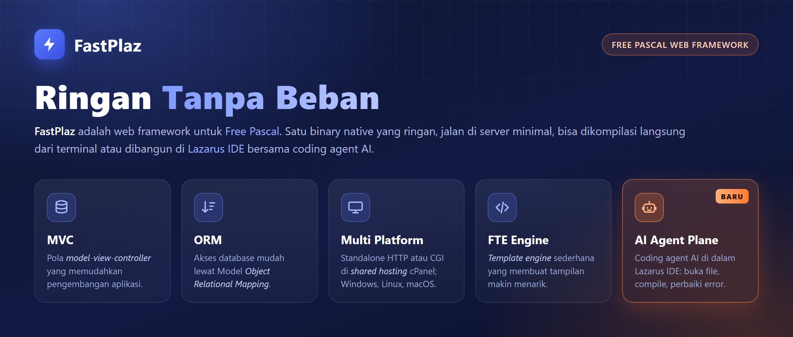
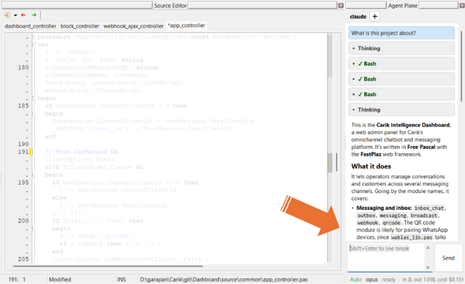
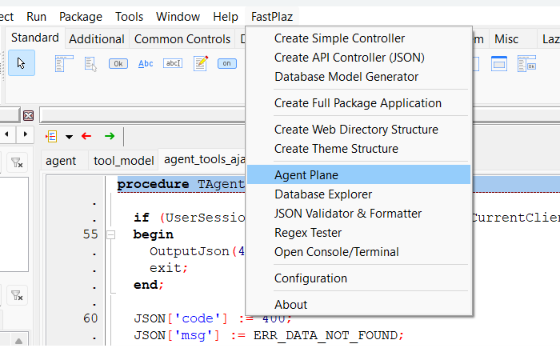
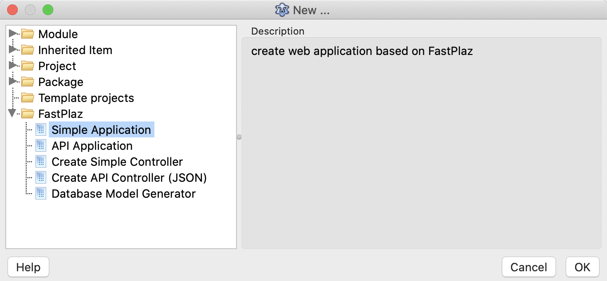

# FastPlaz

**English** | [Bahasa Indonesia](README.id.md)




**Fast, native web applications in Free Pascal.**

[FastPlaz](https://www.fastplaz.com) is a web framework for Free Pascal. Your application compiles to a single native binary that runs on cheap shared hosting as CGI or as its own HTTP server. Build it in the Lazarus IDE with project wizards and a built-in AI coding agent, or straight from the terminal.

## Key features

### One binary, two modes: Standalone and CGI

The same compiled application runs as a **standalone HTTP server** or as **CGI**, chosen when it starts. No code changes between the two.

- **CGI**: deploy directly on shared hosting with cPanel, without your own VPS.
- **Standalone**: run it locally with no web server at all, or as a long-lived service behind nginx.

```bash
./myapp.bin                 # standalone: http://127.0.0.1:8080
./myapp.bin --mode=http --port=8081
# started by Apache as CGI: detected automatically
```

[Deployment guide](docs/STANDALONE-deployment.md) · [Example](examples/standalone)

### AI Agent Plane

Coding agents inside the Lazarus IDE. Claude Code, OpenCode, Pi and GitHub Copilot CLI chat with you in a dockable window and use the IDE itself: open a unit at the right line, read unsaved editor changes, compile the project, read the compiler errors and fix them, and generate FastPlaz controllers and models.



[More about AI Agent Plane](#more-on-ai-agent-plane)

## Why FastPlaz

- **Native speed, tiny footprint.** No interpreter, no runtime to install on the server. One binary plus your theme files.
- **Runs anywhere.** Windows, Linux and macOS; shared hosting, a VPS or a container.
- **MVC that stays simple.** Controllers, routes, themes with template tags, and `TSimpleModel` with a query builder.
- **APIs out of the box.** JSON controllers, CORS, sessions, CSRF tokens, reCAPTCHA, mailer with a built-in SMTP client, Redis.
- **Databases.** MySQL, PostgreSQL, SQLite and Firebird through SQLdb.
- **Batteries for real projects.** Ready-made integrations (OpenAI, Telegram, LINE, Facebook Messenger, Slack, Firebase, Elasticsearch, and more), Indonesian NLP helpers (stemmer, dictionaries).
- **A real IDE experience.** Lazarus wizards for projects, controllers and models, Database Explorer, JSON and Regex tools, and AI Agent Plane.
- **Tested.** More than 700 FPCUnit tests, run on Windows and Linux.

## See the code

A JSON API controller, as generated by the *Create API Controller* wizard:

```pascal
procedure THelloController.Get;
var
  json: TJSONUtil;
begin
  json := TJSONUtil.Create;
  json['code'] := Int16(0);
  json['msg'] := 'Hello from FastPlaz';
  json['data/name'] := _GET['name'];

  Response.ContentType := 'application/json';
  Response.Content := json.AsJSON;
  json.Free;
end;

initialization
  Route['hello'] := THelloController;
```

Querying a table with `TSimpleModel`:

```pascal
if User
  .Select('*')
  .Where('uid > %d AND uid < %d', [5, 10])
  .OrderBy('uid')
  .Limit(10)
  .Open then
begin
  // ...
end;
```

## Quick start

Requirements: [Free Pascal](https://www.freepascal.org/) 3.2.2 and [Lazarus](https://www.lazarus-ide.org/) (Lazarus is optional; you can also compile from the terminal).

1. **Clone** the repository:

   ```bash
   git clone -b development https://github.com/fastplaz/fastplaz.git
   ```

2. **Install the packages** in Lazarus:
   - install `jcfbase` and `jcfidelazarus` (Jedi Code Format) from the Online Package Manager;
   - open `tools/fastplaz_runtime.lpk` and *compile* it;
   - open `tools/fastplaz_tools.lpk`, *compile* and *install* it. Lazarus rebuilds itself and the **FastPlaz** menu appears.

   

3. **Create a project**: *File > New Project ... > Simple Application* (or *API Application*). Choose the HTTP run mode.

   

4. **Run it** and open http://127.0.0.1:8080. The same binary also runs as CGI when Apache starts it.

## More on AI Agent Plane

- **Runtimes**: Claude Code, OpenCode, Pi, GitHub Copilot CLI and other ACP agents. Switch runtime, model and thinking effort from the chat window.
- **IDE tools over MCP**: the IDE runs a local MCP server (127.0.0.1 only, token protected) and hands it to the agent: `open_file`, `read_editor`, `project_info`, `compile_project`, `get_messages`, `create_api_controller`, `create_model` and more.
- **You stay in control**: tools that compile, delete or create files show a permission card first.
- **Live editor**: files the agent changes are reloaded in the open editors.

Read more: [docs/AI_AGENT_by_FASTPLAZ.md](docs/AI_AGENT_by_FASTPLAZ.md) and the MCP tool list in [docs/MCP.md](docs/MCP.md).

## IDE tools

Everything is in the FastPlaz menu.

| Tool | What it does |
| --- | --- |
| Project wizards | Simple Application, API Application, Full Package Application, with the directory and theme structure |
| Controller and model wizards | Simple controller, API (JSON) controller, `TSimpleModel` for a table |
| Database Explorer | Browse connections and tables, copy field lists into your code |
| JSON Validator & Formatter | Check and pretty-print JSON |
| Regex Tester | Try regular expressions against sample text |
| Fast Code Suggestion | Ask an AI model for code from the source editor's popup menu (OpenAI-compatible servers) |
| AI Agent Plane | Coding agents inside the IDE (see above) |


## Deployment

- **CGI**: copy the binary and the `public_html` content to Apache, as on any shared hosting.
- **Standalone HTTP**: the same binary runs as a long-lived server (`--mode=http`, default `http://127.0.0.1:8080`), usually behind nginx or Apache. Graceful shutdown, `max_requests` and per-request database connections are built in.
  - Guide: [docs/STANDALONE-deployment.md](docs/STANDALONE-deployment.md)
  - Design: [docs/STANDALONE-roadmap.md](docs/STANDALONE-roadmap.md)
  - Example: [examples/standalone](examples/standalone)

## Built with FastPlaz

- [Carik](https://carik.id): conversational bot engine for Telegram, WhatsApp and other channels
- [SimpleAI](https://github.com/luridarmawan/SimpleAI): AI platform
- Dashboard Intelligence: analytics dashboard
- [fastplaz.com](https://fastplaz.com): FastPlaz serves the front end, WordPress manages the content
- [Silat Indonesia](https://www.silatindonesia.com)
- [IHASA](https://ihasa.id): Indonesian Horseback & Traditional Archery Association (KPBI)
- [default.fastplaz.com](http://default.fastplaz.com): a plain FastPlaz site

## Documentation

- Tutorials and guides: [fastplaz.github.io](https://fastplaz.github.io/)
- Video tutorials: [FastPlaz on YouTube](https://www.youtube.com/user/fastplaz)
- In this repository:
  - [Templates](README-use%20of%20templates.md)
  - [SimpleModel](README-use%20of%20simplemodel.md)
  - [REST](REST.md)
  - [Integrations](integration.md)
  - [Packages](README-package.md)
  - [CMS](README-CMS.md)
  - [Unit tests](UNIT_TEST.md)
  - [Changes](docs/Changes.md)

## Upgrading from an older version

The November 2026 release contains fixes that change how existing applications behave: session timeout is in minutes, `Redirect`/`die` do not leave the current method, a failed `Save`/`Delete` returns False, flash messages are HTML encoded. Read [docs/UPGRADE.md](docs/UPGRADE.md) and [docs/Changes.md](docs/Changes.md) first.

To update a clone, pull and recompile the packages:

```bash
git pull
```

## Community

- [FastPlaz](https://fastplaz.com)
- [Pascal Indonesia Community](https://pascal-id.org)
- [FastPlaz initiator on GitHub](https://github.com/luridarmawan/)
- [Contributors](README-contributor.md)

## Contributing

Issues and pull requests are welcome. See [CONTRIBUTING.md](CONTRIBUTING.md).

## License

See [LICENSE.txt](LICENSE.txt).
